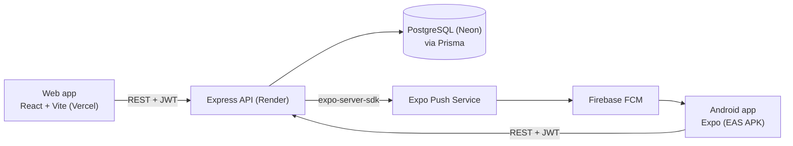
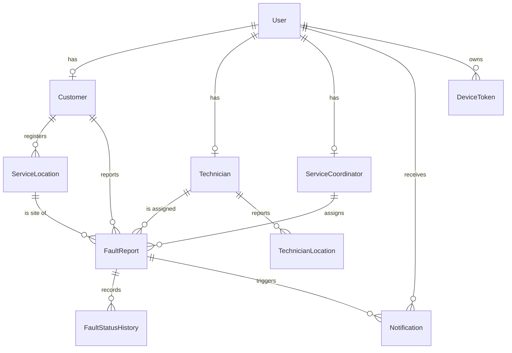

# Architecture

Keep this current: when a change alters a layer, endpoint, table or deployment target, update it in the same
pull request.

One API and one database serve both clients. Live updates are **polling** (every 4 to 15 s), not WebSockets,
which keeps free-tier hosting simple. Push is a courtesy on top of in-app notifications and never fails a request.

## Roles

| Role        | Client       | Can do                                                              |
| ----------- | ------------ | ------------------------------------------------------------------- |
| Guest       | Web          | Report with a phone number and place; follow by private SMS link    |
| Customer    | Web, Android | Report (optional photo), track on a timeline and map, notifications |
| Technician  | Web, Android | See jobs, update status, resolve with outcome, share location       |
| Coordinator | Web          | See and filter all faults, assign, set priority, cancel, analytics  |

A `User` is the login; the role decides which profile row exists (`Customer`, `Technician`,
`ServiceCoordinator`). Only customers self-register (`POST /auth/register`); staff accounts are seeded. Phone is
required and unique (`+2507XXXXXXXX`), email optional. Sign-in takes an email or a phone in one field.

## Backend (`backend/src`)

Flow: `app.js` → `routes/` → `middleware/` → `services/` → Prisma → PostgreSQL. Errors are formatted once by
`middleware/error.js` as `{ error: { message, details } }`.

| Folder                      | Responsibility                                                   |
| --------------------------- | ---------------------------------------------------------------- |
| `routes/`                   | HTTP only: pick middleware, call one service                     |
| `middleware/`               | `auth` (JWT, `requireRole`), `validate` (Zod), `error`           |
| `validators/`               | Zod request-body schemas                                         |
| `services/`                 | Business logic and database access                               |
| `domain/`                   | Pure logic, no I/O: `FaultStatusMachine`, `TechnicianRanker`     |
| `config/`, `lib/`, `utils/` | Env loading, Prisma client, geo distance, constants, HTTP errors |

### Endpoints (under `/api`)

| Method and path                           | Roles                   | Purpose                                      |
| ----------------------------------------- | ----------------------- | -------------------------------------------- |
| `POST /auth/register`, `/auth/login`      | public                  | Create a customer; sign in by email or phone |
| `GET /auth/me`                            | signed in               | Current user                                 |
| `GET /faults`, `GET /faults/:id`          | any (scoped to user)    | List with filters and paging; detail         |
| `POST /faults`                            | Customer                | Report a fault                               |
| `POST /public/faults`, tracking by token  | public                  | Guest report and private tracking link       |
| `PATCH /faults/:id`                       | Coordinator             | Change priority                              |
| `POST /faults/:id/assign`                 | Coordinator             | Assign a technician                          |
| `PATCH /faults/:id/status`                | Technician, Coordinator | Move status, resolve, cancel                 |
| `GET /technicians`                        | Coordinator             | Technicians ranked for a fault (`?faultId=`) |
| `POST /technicians/me/location`           | Technician              | Record device position                       |
| `GET/PATCH /notifications`                | signed in               | In-app notifications                         |
| `POST/DELETE /devices`                    | signed in               | Register or remove a push token              |
| `GET /stats/overview`, `/stats/analytics` | Coordinator             | Dashboard counts and response times          |
| `GET /health`                             | public                  | Health check                                 |

### Key rules

- **Lifecycle** (`FaultStatusMachine`): `REPORTED → ASSIGNED → ON_THE_WAY → ARRIVED → WORKING → RESOLVED`. Only the
  assigned technician moves it one step; a resolution note is required; only a coordinator can cancel.
- **Ranking** (`TechnicianRanker`): availability, then distance, then active jobs, then name.
- **Concurrency** (`faultService.guardedUpdate`): every change is an `updateMany` conditioned on the loaded
  status and technician; a stale update matches zero rows and returns 409.
- **Notifications** are written in the same transaction as the change. Push and SMS go out after commit and never throw.

## Data model (`backend/prisma/schema.prisma`)

`FaultReport` keeps one timestamp per stage so response intervals can be measured. Photos are data URLs of at
most about 1 MB (prototype choice). Never edit an applied migration in `backend/prisma/migrations/`.

## Frontend (`frontend/src`)

- `App.jsx` holds the routes; `RequireRole` keeps each role in `/customer`, `/technician` or `/coordinator`.
- Customer and technician pages use `MobileShell`; coordinator pages use `CoordinatorShell`.
- All HTTP goes through `lib/api.js`; `hooks/useApi.js` loads and polls. Pure logic lives in `lib/` and is unit-tested.
- Leaflet + OpenStreetMap for maps, Recharts for analytics, Tailwind 4 with tokens in `index.css`.

## Mobile (`mobile/`)

- Expo SDK 58 with Expo Router (`app/`: `landing`, `login`, `customer/*`, `technician/*`).
- `src/context/` holds auth, notifications and tracking; `src/lib/` the API client, push, location, photos and
  the secure token store.
- Some web files are copied verbatim (`statusTone.js`, `reportSteps.js`, `landingCopy.js`) and kept in step by
  `frontend/src/lib/sharedWithMobile.test.js`.
- MapLibre with OpenFreeMap tiles (no key). Foreground location is shared while a job is active.

## Quality gates

| Layer         | Check                                                                              |
| ------------- | ---------------------------------------------------------------------------------- |
| All JS        | ESLint (zero warnings), Prettier                                                   |
| Backend types | `tsc --checkJs` via `backend/jsconfig.json`                                        |
| Tests         | Backend and frontend `node --test`, mobile Jest, backend integration on PostgreSQL |
| Builds        | `vite build`, `expo export --platform android`, `expo-doctor`                      |
| CI            | `.github/workflows/ci.yml`; the `ci-ok` job gates merges                           |

## Known limits

Technician positions are simulated on web, photos live in the database, updates are polled, SMS is only logged
unless a phone gateway is connected ([SMS_GATEWAY.md](SMS_GATEWAY.md)), and type-checking covers the backend
only. See [SCOPE_ALIGNMENT.md](SCOPE_ALIGNMENT.md).
