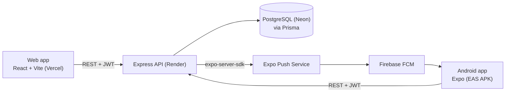
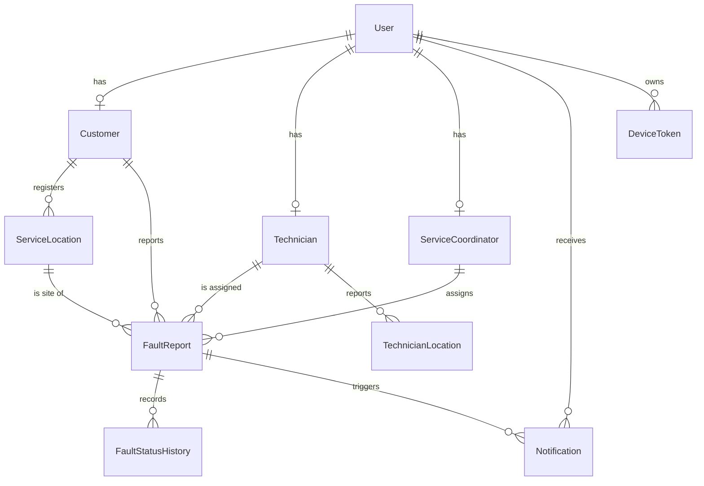

# Architecture

High-level map of the system as it is today. Keep it current: when a change alters anything described here
(a layer, an endpoint, a table, a deployment target), update this file in the same pull request.

## System context

- One API and one database serve both clients. A status change by a technician is visible to the coordinator
  and the customer on their next poll.
- **Live updates are polling**, not WebSockets: the web and mobile `useApi` hooks re-fetch every few seconds
  (about 4 to 5 s). This keeps hosting simple on free tiers.
- Push notifications are a courtesy on top of the in-app notification rows. A failed push never fails a request.

## Roles

| Role        | Client       | Can do                                                                         |
| ----------- | ------------ | ------------------------------------------------------------------------------ |
| Customer    | Web, Android | Report a fault (optional photo), track it on a timeline and map, notifications |
| Technician  | Web, Android | See assigned jobs, update status, resolve with outcome, share location         |
| Coordinator | Web only     | See all faults, filter, assign technicians, change priority, cancel, analytics |

A `User` is the login account. The role decides which profile row exists (`Customer`, `Technician` or
`ServiceCoordinator`). `requireAuth` loads the user with all three profiles and puts it on `req.user`.

## Backend (`backend/src`)

Request flow: `app.js` (CORS, JSON body, logging) → `routes/` → `middleware/` (auth, validation) → `services/`
→ Prisma → PostgreSQL. Errors are formatted once by `middleware/error.js`.

| Folder                      | Responsibility                                                                   |
| --------------------------- | -------------------------------------------------------------------------------- |
| `routes/`                   | HTTP only: pick middleware, call one service                                     |
| `middleware/`               | `auth` (JWT, `requireRole`), `validate` (Zod), `error`                           |
| `validators/`               | Zod request-body schemas per resource                                            |
| `services/`                 | Business logic and database access: fault, technician, notification, push, stats |
| `domain/`                   | Pure logic with no I/O: `FaultStatusMachine`, `TechnicianRanker`                 |
| `config/`, `lib/`, `utils/` | Env loading, shared Prisma client, geo distance, constants, HTTP errors          |
| `types/`                    | Type declarations for the JSDoc type-check (`req.user`)                          |

### Endpoints (all under `/api`)

| Method and path                                                                        | Roles                                              | Purpose                                                      |
| -------------------------------------------------------------------------------------- | -------------------------------------------------- | ------------------------------------------------------------ |
| `POST /auth/login`, `GET /auth/me`                                                     | public / any signed in                             | Sign in (mobile sends `client: "mobile"` for a longer token) |
| `GET /faults`, `GET /faults/:id`                                                       | any (scoped to user)                               | List with filters, fault detail with history                 |
| `POST /faults`                                                                         | Customer                                           | Report a fault                                               |
| `PATCH /faults/:id`                                                                    | Coordinator                                        | Change priority                                              |
| `POST /faults/:id/assign`                                                              | Coordinator                                        | Assign a technician                                          |
| `PATCH /faults/:id/status`                                                             | Technician, Coordinator                            | Move the status, resolve, or cancel                          |
| `GET /technicians`, `GET /technicians/:id`                                             | Coordinator (list), Coordinator + Technician (one) | Technicians, ranked for a fault with `?faultId=`             |
| `POST /technicians/me/location`                                                        | Technician                                         | Record the device position                                   |
| `GET /notifications`, `PATCH /notifications/read-all`, `PATCH /notifications/:id/read` | any signed in                                      | In-app notifications                                         |
| `POST /devices`, `DELETE /devices`                                                     | any signed in                                      | Register or remove an Expo push token                        |
| `GET /service-locations`                                                               | Customer                                           | The customer's registered premises                           |
| `GET /stats/overview`, `GET /stats/analytics`                                          | Coordinator                                        | Dashboard counts and response-time analytics                 |
| `GET /health`                                                                          | public                                             | Health check (used to wake the free-tier API)                |

### Key rules

- **Fault lifecycle** (`domain/FaultStatusMachine.js`):
  `REPORTED → ASSIGNED → ON_THE_WAY → ARRIVED → WORKING → RESOLVED`. Only the assigned technician moves it
  one step forward, a resolution note is required to resolve, and only a coordinator can `CANCEL` an open
  fault. Stages cannot be skipped.
- **Assignment ranking** (`domain/TechnicianRanker.js`): availability (AVAILABLE, ON_JOB, OFF_DUTY), then
  distance to the fault, then number of active jobs, then name. The first available technician is flagged
  `recommended`.
- **Concurrency** (`faultService.guardedUpdate`): every state change is an `updateMany` conditioned on the
  status and technician that were loaded. If another request changed the row first, zero rows match and the
  caller gets a 409.
- **Notifications**: written in the same transaction as the change, so they cannot drift apart. Pushes are
  sent after commit (`pushService`), run in the background, and receipts are checked about 15 minutes later.

## Data model (`backend/prisma/schema.prisma`)

- `FaultReport` stores one timestamp per stage (`reportedAt`, `assignedAt`, `onTheWayAt`, `arrivedAt`,
  `workingAt`, `resolvedAt`, `cancelledAt`) so response intervals can be measured, plus the resolution fields
  (`outcome`, `resolutionNote`, `workCompleted`, `clarificationContacts`).
- `photo` is a data URL string of at most about 1 MB. This is a prototype choice; object storage is future work.
- A `DeviceToken` belongs to one user at a time. Signing in on a shared phone moves the token.
- Migrations live in `backend/prisma/migrations/`. Never edit one that has been applied.

## Frontend (`frontend/src`)

- `App.jsx` defines the routes. `RequireRole` keeps each role inside its own area
  (`/customer`, `/technician`, `/coordinator`).
- Customer and technician pages render in `MobileShell` (phone layout). Coordinator pages render in
  `CoordinatorShell` (desktop layout).
- Data: `lib/api.js` (fetch wrapper) and `hooks/useApi.js` (load plus polling). State: `context/AuthContext`
  and `context/ToastContext`.
- Maps: Leaflet with OpenStreetMap tiles. Charts: Recharts on the analytics page. Styling: Tailwind 4.
- Hosted on Vercel; `vercel.json` rewrites all paths to `index.html` for client-side routing.

## Mobile (`mobile/`)

- Expo SDK 58 with Expo Router. Routes in `app/`: `welcome`, `login`, `customer/*`, `technician/*`.
- `src/context/` holds auth, notifications, tracking and toast state. `src/lib/` holds the API client,
  push registration, foreground location, photo picking and downscaling, and the secure token store
  (`expo-secure-store`).
- Maps use MapLibre with OpenFreeMap tiles (no API key). The technician screen shares foreground location
  while a job is active (`ActiveJobTracker`).
- Built into an installable APK with EAS Build (`eas.json`); the API URL is injected as `EXPO_PUBLIC_API_URL`.

## Quality gates

| Layer          | How it is checked                                                                |
| -------------- | -------------------------------------------------------------------------------- |
| All JS         | ESLint (`eslint.config.js`), Prettier (`.prettierrc.json`)                       |
| Backend types  | `tsc --checkJs` through `backend/jsconfig.json` (non-strict for now)             |
| Backend tests  | `node --test`: unit tests, plus integration tests against a real PostgreSQL      |
| Frontend tests | `node --test` on `src/lib/` only; components and pages are not yet tested        |
| Mobile tests   | Jest (`jest-expo`) and Testing Library                                           |
| Builds         | `vite build` (web), `expo export --platform android` plus `expo-doctor` (mobile) |
| CI             | `.github/workflows/ci.yml`; the `ci-ok` job gates merges                         |

Details of the manual and automated test plan are in `TESTING.md`.

## Deployment

| Part     | Target             | Notes                                                                         |
| -------- | ------------------ | ----------------------------------------------------------------------------- |
| Web app  | Vercel             | Static Vite build                                                             |
| API      | Render (free tier) | Sleeps after about 15 minutes idle; the first request can take up to a minute |
| Database | Neon PostgreSQL    | Migrations applied with `prisma migrate deploy`                               |
| Android  | EAS Build (APK)    | Push needs Firebase Cloud Messaging credentials uploaded to EAS               |

## Known limits and scope decisions

Technician positions are simulated on web, photos live in the database, updates are polled, and there is no SMS.
Details and justification are in `SCOPE_ALIGNMENT.md`. Type-checking covers the backend only. Frontend and
mobile are linted but not type-checked.
